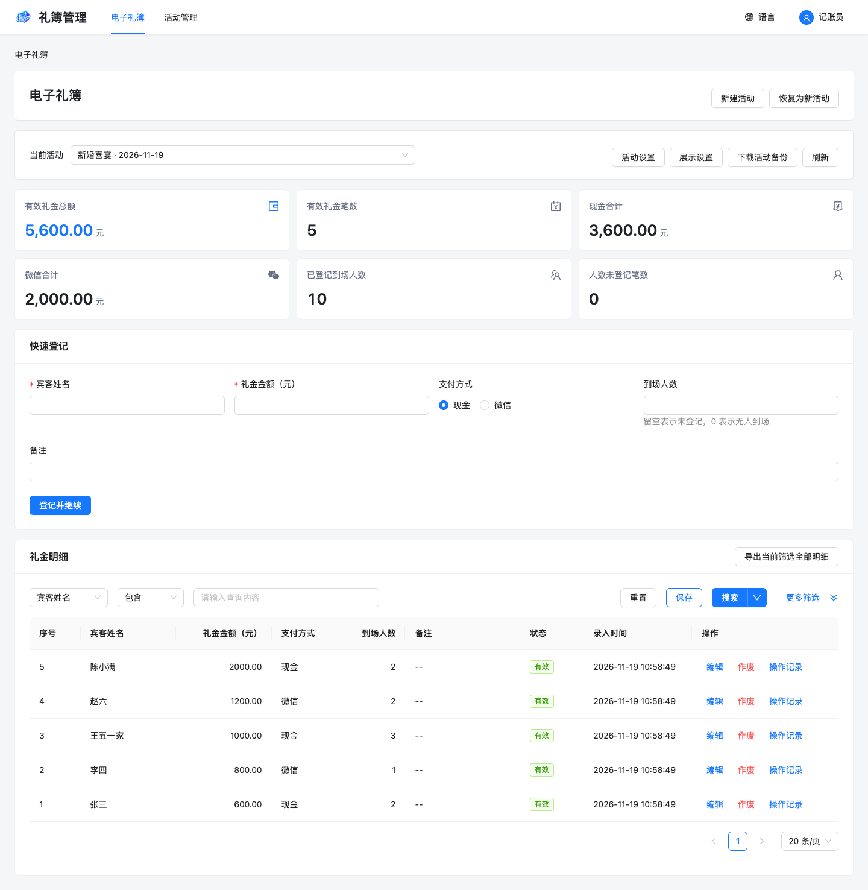
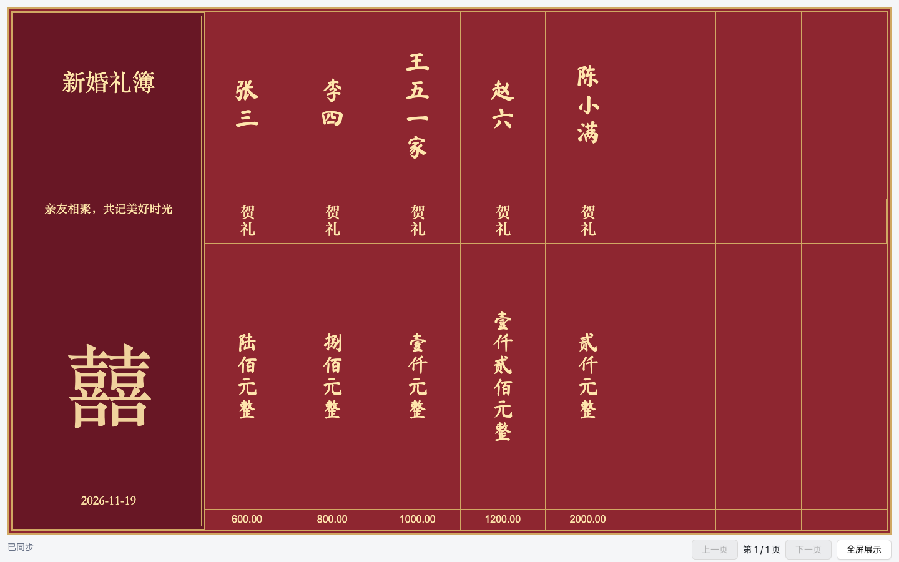
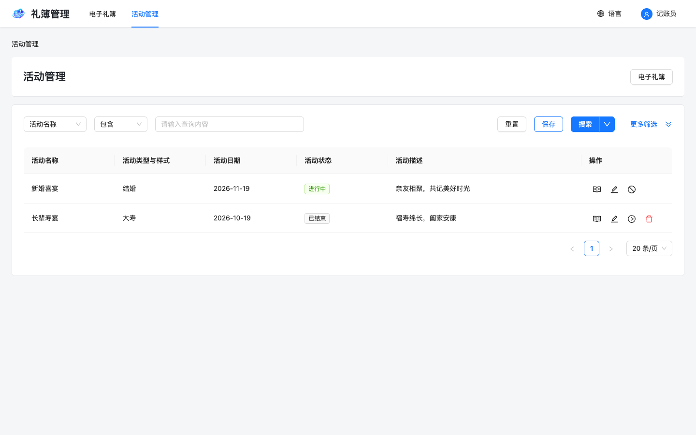
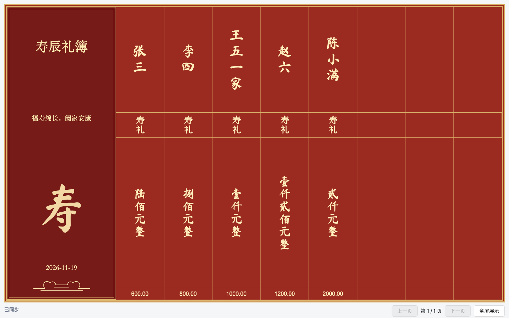
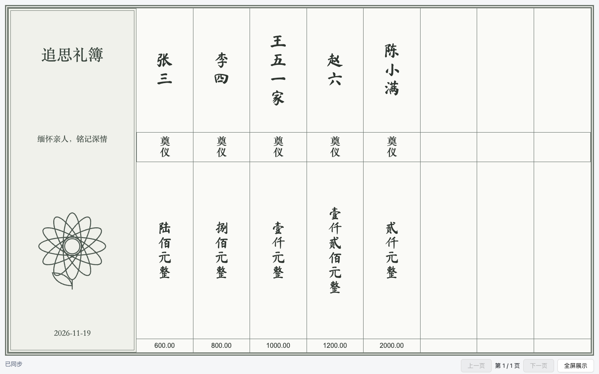

[测试地址：https://gift.vyide.com](https://gift.vyide.com)

# 电子礼簿 · Gift Registry Book UI

面向婚丧喜庆、婴儿庆生、乔迁、升学及开业等场景的电子礼簿前端，提供现场礼金录入、活动管理和独立展示屏。录入人员在管理端登记，展示端通过只读链接打开，适合投屏到电视或大屏。

- [后端仓库](https://github.com/ToolNeo/gift-registry-book)
- [礼簿接口说明](https://github.com/ToolNeo/gift-registry-book/blob/main/docs/gift-registry/API.md)
- [账号与邮箱验证](https://github.com/ToolNeo/gift-registry-book/blob/main/docs/account-email-verification.md)

后端仓库及接口文档需相应访问权限。

## 主要功能

| 模块       | 功能                                                                              |
| ---------- | --------------------------------------------------------------------------------- |
| 活动管理   | 新建、编辑、结束及重新开启活动；按活动类型选择对应样式，填写活动日期与描述        |
| 礼金登记   | 姓名、礼金、现金 / 微信、独立到场人数及备注；支持连续录入、更正、作废和操作记录   |
| 明细与统计 | 筛选礼金记录，查看有效金额、笔数、支付方式汇总及到场人数，导出真正的 `.xlsx` 文件 |
| 展示设置   | 配置必填展示标题、活动照片、每页列数，预览礼簿并生成可反复打开的只读展示链接      |
| 礼簿展示   | 十种活动主题、竖排手写姓名与人民币大写金额、底部两位小数金额、分页与全屏展示      |
| 备份与恢复 | 下载活动 JSON 备份，恢复为新活动，保留原活动数据                                  |
| 账号与权限 | 邮箱验证码注册、首次绑定邮箱、邮箱验证修改密码；菜单、按钮与创建者数据范围控制    |

内置活动类型：结婚、丧事、大寿、满月酒、百天酒、周岁宴、订婚宴、乔迁宴、升学宴、开业庆典。类型选择同时应用于表单预览和独立展示页：婴儿宴采用暖粉、杏金或橙红，订婚采用绛红，乔迁采用青金，升学采用蓝金，开业采用红金；结婚、大寿及丧事保留原有样式。

微信仅用于人工登记支付方式。同名记录仅在当前活动下提醒，核对后可继续保存，不会自动合并。到场人数留空表示未登记，`0` 表示无人到场。

活动尚未结束时不能删除；结束后需要相应权限及明确确认，删除会同时清理该活动的礼金、展示配置和相关记录。单笔礼金通过作废保留操作痕迹。

## 界面预览

以下截图使用本地示例数据，展示当前页面布局；界面标题可通过系统设置调整。

### 礼金录入工作台



### 结婚礼簿展示



<details>
<summary>查看活动管理、大寿与丧事礼簿</summary>

**活动管理**



**大寿礼簿**



**丧事礼簿**



</details>

## 技术栈

Vue 3、TypeScript、Vite、Ant Design Vue、Pinia、Vue Router、Vue I18n 和 Axios。单元测试使用 Vitest，浏览器测试使用 Playwright。礼簿手写字体随项目提供，无需访问远程字体服务；授权见 [字体说明](src/modules/gift-registry-manager-ui/assets/fonts/README.md)。

## 本地开发

需要 Node.js **22.12.0 或更高版本**、pnpm **9.0.6**，以及已启动的配套后端。

```sh
corepack enable
corepack prepare pnpm@9.0.6 --activate
pnpm install --frozen-lockfile
```

在仓库根目录创建 `.env.development.local`，按本地后端地址填写：

```dotenv
VITE_APP_BASE_API=/api
VITE_API_PROXY_TARGET=http://127.0.0.1:8080
VITE_PUBLIC_PATH=/
```

```sh
pnpm dev
```

浏览器打开 `http://127.0.0.1:5173`。开发服务使用固定端口；如果端口已占用，可以用 `pnpm dev --port 5190` 指定其他端口。修改环境文件后需重新启动开发服务。

### 前端配置

| 变量                    | 默认值             | 用途                           |
| ----------------------- | ------------------ | ------------------------------ |
| `VITE_APP_BASE_API`     | `/api`             | 浏览器请求的 API 前缀          |
| `VITE_API_PROXY_TARGET` | 以本地环境文件为准 | Vite 开发代理指向的后端地址    |
| `VITE_PUBLIC_PATH`      | `/`                | 静态资源访问前缀               |
| `VITE_TOKEN_KEY`        | `X-Access-Token`   | 管理接口认证请求头名称         |
| `VITE_LANGUAGE_HEADER`  | `Accept-Language`  | 接口语言请求头名称             |
| `VITE_LEGACY_TOKEN_KEY` | `X-Access-Token`   | 旧登录信息迁移使用的本地存储键 |

`VITE_*` 配置会进入前端构建产物；SMTP 账号、密码及验证码安全策略在后端配置，前端不保存邮件服务凭据。

## 使用流程

1. 登录管理端，在电子礼簿中新建活动，选择活动类型并填写日期和描述。
2. 打开展示设置，填写展示标题，按需上传照片、调整每页列数并保存。
3. 生成展示链接，在另一台设备或独立窗口中打开；同一链接可以重复使用。只有明确重置展示链接时才会撤销旧链接。
4. 在工作台登记礼金，展示屏每 **2 秒通过 HTTP 查询版本**，有变更时加载最新数据，无需连接 WebSocket。
5. 活动结束后按筛选条件导出 Excel 或下载活动备份。

展示页首次打开默认加载最后一页，新增礼金时跟随尾页；普通更正及手动翻页保留当前页。网络临时中断时保留最后成功画面并继续重试，链接撤销后清空展示内容。姓名和大写金额保持各自单个竖列，长文本自动缩字，标题与描述允许换行。

### 账号与访问范围

注册用户名去除首尾空格后为 **5 至 64 位**，页面提供重名检查，最终结果以服务端校验为准。注册时先通过图形验证码，再发送六位邮箱验证码；注册成功后绑定普通用户角色，需要重新登录。修改密码同样需要邮箱验证，首次绑定邮箱有独立入口。

邮件在后台投递，发码后页面显示“邮件发送中”，每 2 秒查询 `SENDING` 状态；服务端确认发送成功后再提示并启用邮箱验证码输入。等待期间请勿重复发送，查询重试不会重复发信。

礼簿查询、修改和删除分别受菜单动作与后端数据范围控制；普通用户默认只访问自己创建的活动。活动管理菜单由服务端菜单配置，常用地址为 `/gift-registry/events`。内置最高管理员和普通角色的区别由后端身份与授权规则决定。

独立展示地址为 `/gift-registry/display/:eventId#token=...`，使用活动只读凭据，宾客无需管理端账号。请使用系统生成的完整链接。

## 检查与构建

```sh
pnpm typecheck       # 产品源码类型检查
pnpm build           # 类型检查并构建到 dist/
pnpm test:gift       # 礼簿单元测试
pnpm test:gift:e2e   # 礼簿浏览器测试
```

礼簿浏览器测试使用独立端口 `5189` 和本机 Chrome，通过 HTTP 示例响应验证真实页面交互，不连接业务后端。运行前请保持该端口空闲。`pnpm test:unit` 可运行脚手架的单元、组件及契约测试集合；该集合与礼簿专用测试配置不同，不能互相替代。

`pnpm lint` 用于全项目规范检查。部分继承的维护脚本需要配套工具目录，使用前请核对 `package.json` 对应入口；本项目推荐以上命令进行礼簿开发验证。

## 部署

执行 `pnpm build` 后，将 `dist/` 部署到静态服务器。使用 History 路由时，服务器需将非静态资源请求回退到 `index.html`，并将 `/api/` 代理到后端。

仓库提供 [Dockerfile](Dockerfile)、[Nginx 配置](nginx.conf) 和 [Compose 配置](compose.yaml)：

```sh
pnpm build
FRONTEND_IMAGE=gift-registry-book-ui:local \
API_BASE_PATH=http://host.docker.internal:8080 \
SERVER_NAME=gift.example.com \
docker compose up -d --build
```

默认映射宿主机端口 `10008`。`API_BASE_PATH` 应填写容器能够访问的后端地址；`SERVER_NAME` 填写实际访问域名。HTTPS 可在外层反向代理配置。Vite 开发代理配置仅作用于开发服务，生产部署需单独配置 Nginx 代理。

## 目录

```text
src/
├── app/                                  # 应用入口、布局、路由与全局状态
├── modules/
│   ├── gift-registry-manager-ui/          # 录入、活动管理、展示及礼簿主题
│   └── authentication-manager-ui/         # 登录、注册、账号和系统管理
└── shared/                               # API 客户端、表单、查询与公共工具
tests/
├── gift/                                 # 礼簿单元及浏览器测试
├── unit/                                 # 通用单元测试
├── component/                            # 组件测试
└── contract/                             # 接口与配置契约测试
docs/screenshots/                         # README 示例截图
```

业务模块的接口消费边界与维护规则见 [礼簿模块说明](src/modules/gift-registry-manager-ui/README.md)。后端负责金额精度、数据权限、并发校验、邮箱发信、导出与持久化，具体约束见配套后端文档。
